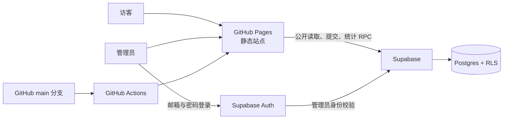

# 川链交接文档

> 面向四川大学师生的常用链接导航与共建目录。本文用于后续维护人员接手网站、Supabase 数据与 GitHub Pages 发布流程。

## 1. 一分钟接手

| 项目 | 地址 / 位置 | 说明 |
| --- | --- | --- |
| 公开网站 | <https://lightluu.github.io/chuanlian/> | 已通过 GitHub Pages 发布 |
| 源代码仓库 | <https://github.com/LightLuu/chuanlian> | 默认分支为 `main` |
| 本地项目目录 | `link-atlas/` | 静态站点、Supabase SQL、测试脚本均在此目录 |
| Supabase 项目 | `afbcdwtkbumkjtaroiil` | 前端配置已接入，勿提交高权限密钥 |
| 本地预览 | `npm run serve` | 打开 <http://localhost:4173/> |

当前站点使用静态前端 + Supabase 的组合：GitHub Pages 负责页面托管，Supabase 负责数据、管理员认证、链接审核与访问统计。

## 2. 当前交付状态

- 品牌已统一为“川链”，网页标题为“川链｜四川大学链接导航”。
- 首页支持分类浏览、关键词/标签搜索、链接跳转与点击统计。
- 访客可提交链接；管理员可审核、发布、编辑、下架链接并管理分类、标签和数据统计。
- GitHub Pages 自动部署工作流已启用，`main` 分支有新提交时自动发布 `site/` 目录。
- 已整理并提交 8 个四川大学官方常用入口至待审核队列，尚需管理员审核发布。
- 已完成静态测试和真实 Supabase 公共读取检查。

### 待完成的关键事项

1. 在 Supabase 创建并授权至少一个管理员账号；当前历史核验曾显示 `admin_count = 0`，未授权账号无法进入后台。
2. 在后台创建或确认“校务服务、教学学习、学习科研、就业发展、校园生活”等分类。
3. 审核发布 8 条川大链接，使其显示在首页。
4. 由仓库管理员核对 GitHub 文件树；首次网页上传阶段保留了少量不参与发布的重复文件，可在确认后删除。

## 3. 系统结构



### 核心目录

```text
link-atlas/
├── site/                         # GitHub Pages 实际发布目录
│   ├── index.html                # 页面结构、路由容器与安全策略
│   └── assets/
│       ├── app.js                # 前端逻辑、Supabase REST/Auth 调用
│       ├── config.js             # Supabase URL 与 Publishable Key
│       └── styles.css            # 页面样式与响应式布局
├── supabase/
│   ├── schema.sql                # 表、RLS、策略、函数与初始数据
│   └── verify.sql                # 部署后只读核验 SQL
├── scripts/check-supabase.mjs    # 公共接口连通性检查
├── tests/static.test.mjs         # 静态完整性与安全配置检查
├── .github/workflows/deploy-pages.yml
└── README.md
```

## 4. 数据与权限

### 主要数据表

| 表 | 用途 | 访客权限 | 管理员权限 |
| --- | --- | --- | --- |
| `categories` | 分类与颜色、排序 | 读取 | 全量维护 |
| `links` | 已发布/下架的链接 | 仅读取已发布链接 | 全量维护 |
| `tags`、`link_tags` | 标签及链接关联 | 读取公开标签 | 全量维护 |
| `submissions` | 访客待审核提交 | 仅可新增待审核记录 | 审核、发布、拒绝 |
| `site_daily_stats` | 按日聚合页面访问量 | 读取 | 全量维护 |
| `audit_logs` | 管理员操作记录 | 无 | 读取与写入 |
| `admin_users` | 管理员白名单 | 无 | 通过数据库维护 |

所有表已启用 RLS。前端只使用 Publishable Key；数据库密码、`service_role` 或 `sb_secret_` 密钥不得放进浏览器配置、仓库或 GitHub Actions。

### 管理员账号初始化

1. 打开 Supabase Dashboard → **Authentication → Users**。
2. 创建一个邮箱/密码用户，并确认邮箱状态（可在创建时启用 Auto Confirm）。
3. 在 SQL Editor 执行下列 SQL，将该用户列为站点管理员：

```sql
insert into public.admin_users (user_id, email)
select id, email
from auth.users
where email = '管理员邮箱'
on conflict (user_id) do update
set email = excluded.email;
```

4. 执行 `supabase/verify.sql`；确认结果中的 `admin_count` 至少为 `1`。
5. 在网站 `#/admin` 中使用该邮箱和密码登录。

> 数据库密码不是网站管理员密码。网站管理员密码仅由 Supabase Authentication 管理，无法查看明文；忘记时应在 Dashboard 重设。

### 统计函数

| 函数 | 调用方 | 作用 |
| --- | --- | --- |
| `record_page_view(p_path)` | 访客页面 | 聚合记录页面浏览次数 |
| `record_link_click(p_link_id)` | 访客点击链接 | 累加公开链接点击次数 |
| `check_url_exists(p_url)` | 提交表单 | 避免与已发布/待审核 URL 重复 |
| `is_admin()` | 管理端 | 校验当前登录用户是否在 `admin_users` 中 |

## 5. 川大链接审核清单

已提交以下官方入口，建议按表中的分类创建分类后审核发布：

| 建议分类 | 名称 | 地址 | 建议标签 |
| --- | --- | --- | --- |
| 校务服务 | 四川大学网上办事大厅 | <https://my.scu.edu.cn/> | 川大、校务、办事、统一认证 |
| 校务服务 | 四川大学统一身份认证 | <https://id.scu.edu.cn/frontend/login/> | 川大、登录、认证、账号 |
| 教学学习 | 四川大学教务管理系统 | <https://zhjwjs.scu.edu.cn/> | 川大、本科、教务、选课、成绩 |
| 教学学习 | 四川大学教务处 | <https://jwc.scu.edu.cn/index.htm> | 川大、本科、教务、通知 |
| 教学学习 | 大川学堂 | <https://ecourse.scu.edu.cn/learn/> | 川大、课程、学习平台、在线学习 |
| 学习科研 | 四川大学图书馆 | <https://lib.scu.edu.cn/> | 川大、图书馆、文献、数据库、学习 |
| 就业发展 | 四川大学就业指导中心 | <https://jy.scu.edu.cn/index.html> | 川大、就业、招聘、实习、校招 |
| 校园生活 | 四川大学心理健康教育中心 | <https://xljkjyzx.scu.edu.cn/> | 川大、心理健康、咨询、校园生活 |

审核步骤：进入 `#/admin` → **待审核** → 选择一条提交 → 选择分类、确认标签与简介 → **通过并发布**。

## 6. 发布与更新

### 日常更新流程

```bash
# 在项目目录执行
npm test
npm run test:live
git add .
git commit -m "说明本次更新"
git push origin main
```

推送后 GitHub Actions 工作流会自动执行 `.github/workflows/deploy-pages.yml`，将 `site/` 发布到 GitHub Pages。可在仓库 **Actions** 页面确认工作流成功；通常在数分钟内生效。

### 初次或故障后核验

```bash
npm test
npm run test:live
curl -I https://lightluu.github.io/chuanlian/
```

此外，应在浏览器中检查：首页搜索、提交表单、管理员登录、审核发布、链接点击数与页面访问数。

### 回滚

如果最新版本有问题，在 GitHub 的 `main` 分支将代码恢复到上一个正常提交后再次推送；GitHub Pages 会自动重新部署。数据库数据不会随 Git 回滚，涉及分类、链接或审核记录时应在管理员后台或 Supabase SQL Editor 单独处理。

## 7. 常见问题

### 管理员登录失败

优先检查：

1. 邮箱/密码是否为 Supabase Auth 用户，而不是数据库密码。
2. 用户是否已完成邮箱确认。
3. 用户 UUID 是否已写入 `public.admin_users`。
4. `supabase/verify.sql` 的 `admin_count` 是否大于 0。

### 页面加载不到数据

检查 `site/assets/config.js` 中的 Project URL 与 Publishable Key，随后运行：

```bash
npm run test:live
```

如果公开读取失败，检查 Supabase 的 Data API、表的 RLS 策略，以及 `categories`、已发布 `links` 的公开读取策略。

### GitHub Actions 发布失败

确认仓库 **Settings → Pages → Source** 已选择 **GitHub Actions**，并检查工作流是否对 `main` 分支触发。工作流发布路径固定为 `site/`，不要把首页或 `assets/` 移出该目录。

## 8. 交接证据链

### E-001

- title: 静态站点与 GitHub Pages 工作流已配置
- observed_at: 2026-11-11
- source_type: file
- source_ref: `.github/workflows/deploy-pages.yml`
- content_hash: n/a
- repro_command: `sed -n '1,160p' .github/workflows/deploy-pages.yml`
- raw_excerpt: 工作流监听 `main`，上传 `site/`，使用 `actions/deploy-pages@v4`。
- linked_workitem: n/a
- supersedes: none

### E-002

- title: Supabase 数据表、RLS 与统计函数已定义
- observed_at: 2026-11-11
- source_type: file
- source_ref: `supabase/schema.sql`
- content_hash: n/a
- repro_command: `rg -n "enable row level security|record_page_view|record_link_click|is_admin" supabase/schema.sql`
- raw_excerpt: 8 张核心表启用 RLS，并包含管理员校验与访问统计函数。
- linked_workitem: n/a
- supersedes: none

### E-003

- title: 前端和 Supabase 公共接口检查可执行
- observed_at: 2026-11-11
- source_type: command
- source_ref: `package.json`
- content_hash: n/a
- repro_command: `npm test && npm run test:live`
- raw_excerpt: `test` 检查前端静态完整性，`test:live` 读取公开分类和链接接口。
- linked_workitem: n/a
- supersedes: none

### F-001

- title: 管理员白名单是后台管理的必要前置条件
- severity: info
- category: design
- status: validated
- evidence_ids: [E-002]
- location: `supabase/schema.sql` 中 `admin_users`、`is_admin()` 和 RLS 策略
- impact: 未写入 `admin_users` 的认证用户无法审核和发布访客提交。
- confidence: high
- repro_steps:
  1. 创建仅有 Auth 身份的用户。
  2. 登录 `#/admin`。
  3. 系统拒绝该用户的管理员权限。
- remediation: 按第 4 节的 SQL 将用户加入管理员白名单。
- optional_attack:

### P-001

- title: 内容从访客提交到公开发布的路径
- path_type: callflow
- start: 访客填写提交表单
- goal: 公开链接出现在首页并可统计点击
- steps:
  1. action: 访客提交 URL、简介、建议分类和标签；evidence: E-002；finding: none
  2. action: 数据写入 `submissions` 待审核队列；evidence: E-002；finding: F-001
  3. action: 管理员登录、复核内容并发布为 `links` 与标签关联；evidence: E-002；finding: F-001
  4. action: 访客读取公开链接并通过统计函数记录页面/链接访问；evidence: E-002；finding: none
- residual_risks: 管理员未完成授权时，待审核内容不会自动公开。

## 9. 维护交接清单

- [ ] 验证至少一个 Supabase Auth 管理员已加入 `admin_users`。
- [ ] 在后台创建川大链接所需分类并审核发布待审核内容。
- [ ] 每次改动前后运行 `npm test`；涉及真实数据时再运行 `npm run test:live`。
- [ ] 不在 GitHub、前端配置或聊天记录中保存数据库密码和高权限密钥。
- [ ] 定期检查 GitHub Actions 与 Supabase Dashboard 的错误提示。
- [ ] 清理确认无用的网页上传重复文件，并保持 `site/` 目录结构不变。
